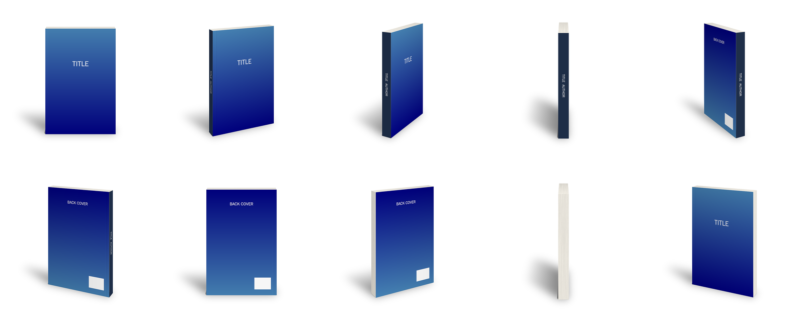

# book-mockup

Renders a photographic mockup of an upright book from flat artwork: front
cover, spine and (optionally) back cover. The book can be turned to any
angle through 360°, viewed from any height, and is lit consistently with a
soft floor shadow. Everything is done in one [GEGL](https://gegl.org) graph.



## Install

With Homebrew, from the companion tap:

```sh
brew install YOUR_GITHUB_USER/tap/book-mockup
```

From source (needs GEGL 0.4 and `pkg-config`/`pkgconf`):

```sh
make
make install PREFIX="$HOME/.local"   # or sudo make install
```

## Usage

```sh
book-mockup -c cover.png -s spine.png -k back.png -o mockup.png
```

Common variations:

```sh
book-mockup -c cover.png -s spine.png -a 155 -k back.png  # back view
book-mockup -c cover.png -s spine.png -e 1.4               # look down on the pages
book-mockup -c cover.png -s spine.png -g none              # transparent PNG
```

Cover and spine should come from the same cover wrap at the same
resolution: the book's thickness is taken from the spine image's width
relative to the cover's height.

Artwork and textures can be PNG, JPEG, TIFF or WebP (chosen by file
extension, case-insensitive).

### Options

| Option | Meaning | Default |
|---|---|---|
| `-c`, `--cover=FILE` | Front cover image | *required* |
| `-s`, `--spine=FILE` | Spine image | *required* |
| `-k`, `--back=FILE` | Back cover image | plain board |
| `-o`, `--output=FILE` | Output file; format follows the extension | `mockup.png` |
| `-a`, `--angle=DEG` | Rotation: 0 front, 90 spine, 180 back, 155 back with spine | `25` |
| `-f`, `--focal=PX` | Focal length in pixels; larger is flatter | `6000` |
| `-W`, `--width=PX` | Canvas width | `2400` |
| `-H`, `--height=PX` | Canvas height | `2400` |
| `-b`, `--book-height=PX` | Book height on the canvas | `1800` |
| `-e`, `--camera-height=N` | Eye height above the floor, × book height; above 1 shows the top | `0.5` |
| `-g`, `--background=COLOR` | Background color, or `none` for transparent | `white` |
| `--shadow-direction=DEG` | Shadow direction from straight back, + is left | `40` |
| `--shadow-length=N` | Shadow length, × book height | `0.55` |
| `--shadow-opacity=N` | Cast shadow opacity | `0.55` |
| `--page-lines=N` | Strength of page-edge lines (0 disables) | `0.18` |
| `--page-grain=N` | Strength of paper grain on the pages (0 disables) | `0.05` |
| `-t`, `--texture=FILE` | Texture image for the cover stock (covers and spine) | none |
| `--texture-strength=N` | Strength of `--texture` | `0.15` |
| `--cover-grain=N` | Noise grain on covers and spine | `0` |
| `--seed=N` | Base seed for generated noise; output is reproducible | `1` |
| `--crease=N` | Depth of the hinge creases (0 disables) | `0.35` |
| `--crease-offset=N` | Crease distance from the spine, × book height | `0.03` |
| `--crease-width=N` | Crease width, × book height | `0.006` |

### Notes

- **Transparent output.** With `-g none` the shadow is pure `#000000` with
  varying alpha, so it composites cleanly onto any background. Rendering
  on white and removing the white later leaves a gray shadow; use `-g none`
  for assets that will sit on other backgrounds.
- **Focal length is in pixels.** If you shrink the book with `-b`, shrink
  `-f` in proportion to keep the same viewpoint (the default is about
  3.3 × book height).
- **Linear light.** Shading and textures work in linear light, as GEGL
  does internally, so strengths read a little lighter than the same numbers
  would in an sRGB editor.

## Code layout

`book-mockup.c` is a single file organized in four strata, each depending
only on those above it, so a leading portion can be reused in another
project:

1. **Math** — points, quads, homographies, convex hulls.
2. **Scene** — pinhole camera, textured faces, a rotating six-sided box,
   lighting and the floor shadow.
3. **Render** — generic GEGL graph builders.
4. **App** — the book itself: options, command line and `main()`.

Strata 1–3 know nothing about books; another box-shaped product needs only
a new stratum 4. Sections are separated by page breaks (`C-x ]` and
`C-x [` in Emacs).

## License

GPL-3.0-or-later. See [COPYING](COPYING).
